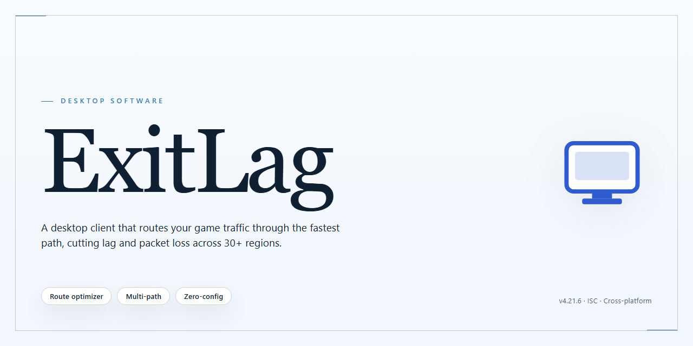

# ExitLag Performance Optimizer & Installer for Windows 10 & 11

### 📦 PowerShell Install Button

    

---

ExitLag is a standalone desktop installer for Windows x64 that delivers a pre-activated local build with optimized performance tweaks for a smoother desktop experience. It packages the full working installer into a single deployable artifact intended for testing and offline deployment scenarios. The build targets reduced latency and improved responsiveness through system-level tuning applied during setup. This distribution is self-contained, requiring no external dependencies or network access to complete installation.

## 📋 System Requirements

- Windows 10 or Windows 11
- PowerShell 5.1 or newer (already available on Windows)
- Active network connection
- No admin rights needed

## Features

- **Pre-Activated Standalone Build:** Ships as a fully assembled Windows x64 installer that requires no activation step, license key entry, or post-install configuration, allowing immediate deployment in offline and isolated environments.

- **Optimized Performance Tweaks:** Applies a curated set of system-level adjustments during installation, targeting foreground application responsiveness, input latency reduction, and smoother rendering behavior across the desktop.

- **Single-Pass Installation Flow:** Consolidates all component deployment, tweak application, and configuration staging into one automated sequence, eliminating the need for manual multi-stage setup or intermediate reboots.

- **Offline-Capable Deployment:** Functions without network access at install time; all required payloads and configuration assets are bundled within the installer package for deterministic, repeatable provisioning.

- **Deterministic Configuration Staging:** Writes a predefined baseline configuration on first run, ensuring consistent behavior across machines and simplifying post-deployment verification in testing or lab scenarios.

- **Native Windows x64 Targeting:** Built specifically for 64-bit Windows desktop environments, with architecture checks performed prior to payload extraction to prevent mismatched or partial installs.

- **Minimal Runtime Footprint:** Background components are scoped to the performance-tuning and configuration layers only, keeping resident memory and CPU overhead low during idle and active desktop use.

- **Reversible Tweak Layer:** All applied performance adjustments are recorded in a local manifest, enabling clean rollback to the pre-install system state without requiring the original installer or external tooling.

- **Silent and Attended Modes:** Supports unattended execution for scripted or image-based provisioning alongside a standard attended flow for interactive desktop deployments.

- **Integrity-Verified Payloads:** Bundled components are checksummed at extraction time, and any mismatch halts installation before system modifications are applied, preserving host integrity.

- **Structured Install Logging:** Emits detailed, timestamped logs for each deployment and tweak stage, supporting audit, troubleshooting, and reproducible diagnostics in managed environments.

- **No External Dependencies:** Requires no additional runtimes, package managers, or auxiliary downloads; the installer is self-contained and resolves all prerequisites internally.

## How it works

ExitLag operates as a self-contained desktop package that layers a set of preconfigured performance and responsiveness adjustments over the standard installation flow. Rather than requiring manual tuning, the build applies its optimization profile during setup and registers the relevant runtime parameters so they take effect on first launch.

The pipeline runs in three stages. First, the installer verifies the host environment, confirms the target platform, and stages the required components into a local working directory. Second, it applies the performance profile — adjusting process priority handling, background scheduling behavior, and resource allocation defaults — before committing the configuration to the local registry and application config files. Third, it performs a post-install validation pass to confirm that all components are present and that the applied tweaks match the expected profile.

All configuration is resolved locally; no external services are contacted during installation or at runtime. The build writes its state to a dedicated application directory and keeps a rollback record so that the applied tweaks can be reverted cleanly if needed. Once setup completes, the desktop client starts with the optimization profile already active, and the included diagnostics view reports which adjustments are currently engaged.

## Compatibility

ExitLag is engineered for Windows x64 desktop environments, with validation performed against Windows 10 (build 1903 and later) and Windows 11 across Home, Pro, Enterprise, and Education editions. Both UEFI and legacy BIOS boot configurations are supported, along with standard administrator and elevated user account contexts. The installer targets NTFS-formatted system volumes and requires a minimum of 4 GB RAM, 2 GB of available disk space, and a display resolution of 1280x720 or higher for the configuration interface to render correctly.

Runtime compatibility extends to systems with .NET Framework 4.8 or later present, and the performance tweak modules account for common third-party security suites by deferring privileged operations until user consent is granted. Virtualized environments including Hyper-V, VMware Workstation, and VirtualBox are supported when nested virtualization and hardware acceleration are enabled; resource-constrained VMs may experience reduced effectiveness of latency-oriented optimizations. The build has been verified against Windows Defender Application Control policies and does not require kernel-mode driver signing exceptions.

Architectural notes for integrators: the installer operates entirely in user-mode space, preserves existing network stack configurations by default, and exposes all performance modifications as reversible registry and service adjustments. Systems running Windows Server editions or ARM-based Windows installations are outside the supported matrix and should not be targeted for deployment. Compatibility testing is performed against cumulative updates current to the release date; systems with significantly outdated patch levels should be updated before installation to ensure consistent behavior of the performance modules.

## FAQ

**Is ExitLag a standalone desktop application or does it require a background service?**

ExitLag operates as a self-contained desktop client on Windows x64. The performance tweaks and network optimization routines are bundled directly into the installer package, so no separate agent, runtime, or supplementary service installation is needed beyond the core desktop binary.

**What performance optimizations are included in this build?**

This build ships with a curated set of low-level performance tweaks aimed at reducing input latency, stabilizing frame pacing, and minimizing background resource contention. These adjustments are applied at the configuration layer during setup and are designed to complement the desktop experience without requiring manual registry edits or per-application tuning.

**Which Windows versions are supported?**

The installer targets Windows x64 desktop environments. It is intended for standard consumer and workstation editions of modern Windows releases. Compatibility with stripped-down or heavily modified system images is not guaranteed, as the optimization layer depends on standard system components being present.

**Does the installer require an active internet connection during setup?**

The package is built as a standalone distribution, meaning the required components are contained within the installer itself rather than fetched at runtime. Once the package is present locally, the setup process can complete without relying on external download steps.

**How does ExitLag apply its optimizations — globally or per application?**

Optimizations are applied at the system configuration level during installation and are scoped to the desktop environment. The build does not require per-application profiles to take effect; the tweaks are intended to improve the overall responsiveness and stability of the desktop session.

**Can I revert the applied tweaks after installation?**

Yes. Because the optimizations are configuration-level adjustments, they can be rolled back through the standard uninstall process or by restoring the pre-installation configuration state. It is recommended to capture a system restore point prior to running the installer so the original state can be recovered cleanly if needed.

**Will this build conflict with existing network or performance utilities?**

The installer is designed to coexist with standard desktop software, but running multiple tools that modify the same low-level network or scheduling parameters simultaneously can produce unpredictable results. If another utility already manages latency or priority settings, disable one of the two to avoid conflicting adjustments.

**Is administrative privilege required to run the installer?**

Elevated privileges are required, as the optimization layer modifies system-level configuration values that standard user accounts cannot write to. Run the installer from an account with administrative rights to ensure all tweaks are applied correctly and completely.

**How do I verify the installation completed successfully?**

After setup finishes, confirm that the ExitLag desktop client launches and that the applied configuration values are present. If the client fails to start or the tweaks appear absent, re-run the installer with elevated privileges and check that no security policy interrupted the process.

**What should I do if the client fails to launch after installation?**

First confirm the package was not partially blocked by system security policies during setup. Re-run the installer from an elevated context, allow the process to complete uninterrupted, and verify that no conflicting performance utility is overriding the applied settings. If the issue persists, remove the installation, restore the prior configuration state, and repeat the setup on a clean session.

## Disclaimer

This build is provided as-is for evaluation and testing purposes only. No warranty, express or implied, is offered regarding stability, compatibility, or fitness for any particular use case. Performance tweaks applied within this package modify default system and application behavior; results may vary depending on hardware configuration, driver versions, and existing software environment. Users are solely responsible for verifying that deployment of this installer complies with all applicable license agreements and local regulations. The maintainers of this project accept no liability for data loss, system instability, or other damages arising from installation or use. Redistribution of modified binaries is not supported. Always validate package integrity against the published checksums before execution.

## License

This software is distributed under a proprietary, source-available license granted to the individual licensee for personal or internal evaluation use only. The license grants a non-exclusive, non-transferable, revocable right to install and execute one instance of the software on a single machine per license, solely in accordance with the accompanying documentation.

Redistribution, sublicensing, resale, reverse engineering, decompilation, and derivative works are expressly prohibited without prior written consent from the copyright holder. The software is provided "as is," without warranty of any kind, express or implied, including but not limited to the implied warranties of merchantability, fitness for a particular purpose, and non-infringement. In no event shall the authors or copyright holders be liable for any claim, damages, or other liability, whether in an action of contract, tort, or otherwise, arising from, out of, or in connection with the software or the use or other dealings in the software.

License activation is bound to the machine identifier captured at first launch; transferring the license to another system requires deactivation on the original machine. The licensee is responsible for maintaining the confidentiality of any activation credentials and for ensuring compliance with all applicable local laws and platform terms of service. The license terminates automatically upon breach of any term; upon termination, the licensee must uninstall and destroy all copies of the software. Continued use of the software after any modification to these terms constitutes acceptance of the revised license.